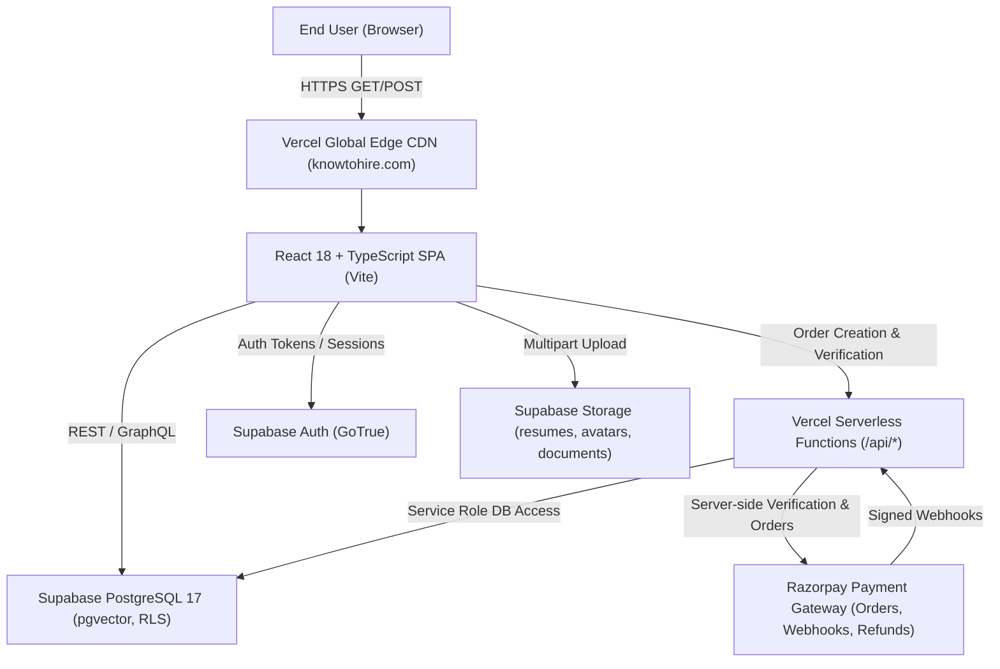
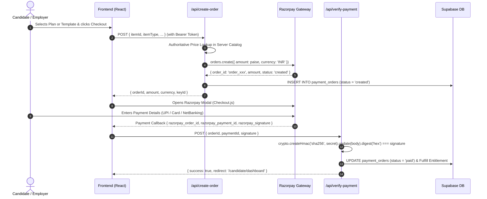

# KnowToHire.com — Technical Handover Document

**Document Version:** 1.0.0 (Production Release)  
**Date:** November 11, 2026  
**Target System:** `https://www.knowtohire.com`  
**GitHub Repository:** `https://github.com/SuryaNaikoti/knowtohire`  
**Release Commit:** `49d36ac26842781c63c72e4797ab2a458337f03c`  
**Production Database:** Supabase (`roqbodprqmnwxdjsskgb`, Singapore `ap-southeast-1`)  
**Frontend Hosting:** Vercel (`bom1` Edge Network / Mumbai PoP)

---

## 1. System Architecture Overview

KnowToHire is an integrated job marketplace, knowledge repository, and digital template platform built using modern JAMstack principles:



### Core Technologies
- **Frontend:** React 18.3, TypeScript 5.5, Vite 5.4, Tailwind CSS, Lucide React icons.
- **Backend / Database:** Supabase PostgreSQL 17, PostgREST API, Supabase Storage API, GoTrue Auth.
- **Serverless Compute:** Vercel Node.js Serverless Functions (`/api/create-order.ts`, `/api/verify-payment.ts`, `/api/razorpay-webhook.ts`, `/api/refund-payment.ts`, `/api/contact.ts`).
- **Payment Infrastructure:** Razorpay SDK (Standard Checkout, Webhook HMAC-SHA256 signature verification, Idempotent Lease Processing).

---

## 2. Database Schema & Architecture

The database runs on Supabase PostgreSQL with automated Row Level Security (RLS) enabled across all public tables.

### Key Public Tables
1. **`jobs`**: Core job listings table (61 columns).
   - *Columns of note:* `id`, `title`, `company_id`, `employer_id`, `description`, `skills`, `department`, `location`, `status` (`draft`, `published`, `archived`), `is_active`, `is_featured`, `featured_start_date`, `featured_end_date`, `featured_duration_days`, `created_at`, `published_at`.
   - *Indexes:* `idx_jobs_featured_published`, `idx_jobs_status_active`.
2. **`companies`**: Employer organisation profiles (`id`, `name`, `logo_url`, `website`, `description`, `industry`, `size`).
3. **`templates`**: Downloadable digital assets (`id`, `title`, `description`, `price_cents`, `selling_price_inr`, `download_url`, `formats`, `status`, `downloads_count`).
4. **`blog_posts`**: Editorial articles and guides (`id`, `title`, `slug`, `content`, `excerpt`, `author_name`, `status`, `view_count`, `published_at`).
5. **`job_applications`**: Applications submitted by candidates (`id`, `job_id`, `candidate_id`, `resume_url`, `status`, `created_at`).
6. **`candidate_profiles`**: Candidate CV data, skills, education, and career preferences.
7. **`employer_profiles`**: Employer billing info, ATS settings, and subscription status.
8. **`payment_orders`**: Authoritative server-side transaction ledger (`order_id`, `user_id`, `amount_paise`, `currency`, `status`, `item_type`, `item_id`, `payment_id`, `created_at`).

### Applied Database Migrations
- `supabase/migrations/20261110000000_add_featured_job_columns_and_safe_sorting.sql`:
  - Adds `is_featured` (BOOLEAN DEFAULT false NOT NULL).
  - Adds `featured_start_date` (TIMESTAMPTZ NULL).
  - Adds `featured_end_date` (TIMESTAMPTZ NULL).
  - Adds `featured_duration_days` (INTEGER NULL).
  - Creates composite performance index on `(is_featured DESC, published_at DESC NULLS LAST)`.

---

## 3. Security & Row Level Security (RLS)

All database access from the client browser is mediated by Supabase Row Level Security:

1. **`jobs` Table:**
   - Public read access for records where `status = 'published'` and `is_active = true`.
   - Write/Update restricted strictly to the employer whose `employer_id` matches `auth.uid()`.
2. **`candidate_profiles` & `employer_profiles`:**
   - Isolated to the authenticated owner (`auth.uid() = user_id`). Unauthenticated queries return 0 rows.
3. **`job_applications`:**
   - Candidates can only SELECT applications where `candidate_id = auth.uid()`.
   - Employers can only SELECT applications for jobs where `jobs.employer_id = auth.uid()`.
4. **`resumes` Storage Bucket:**
   - Private bucket (`public = false`).
   - Authenticated candidates upload to their own path (`resumes/<candidate_id>/*`).
   - Direct anonymous downloads and path traversals return HTTP 403 Forbidden.

---

## 4. API Endpoints & Serverless Architecture

The Vercel serverless layer resides in `/api`:

| Route | HTTP Method | Description | Security Controls |
|---|---|---|---|
| `/api/create-order` | POST | Creates Razorpay order | Validates authenticated user, enforces server-side authoritative pricing catalog |
| `/api/verify-payment` | POST | Verifies payment signature | Validates HMAC-SHA256 signature, enforces amount equality in paise, prevents payment ID reuse |
| `/api/razorpay-webhook`| POST | Handles async payment webhooks | Enforces webhook secret signature, distributed lease token lock, idempotent delivery |
| `/api/refund-payment` | POST | Initiates order refund | Admin-only role check, updates `payment_orders` status to `refunded` |
| `/api/contact` | POST | Processes contact form inquiries | Input sanitization, rate-limiting |

---

## 5. Deployment & Environment Configuration

### Git Repository & Production Branch
- **Remote:** `https://github.com/SuryaNaikoti/knowtohire`
- **Production Branch:** `main` (automatically deployed by Vercel on push).

### Required Environment Variables
#### Client-Side (Vite / Browser Bundle)
- `VITE_SUPABASE_URL`: `https://roqbodprqmnwxdjsskgb.supabase.co`
- `VITE_SUPABASE_ANON_KEY`: `eyJhbGciOiJIUzI1NiIsInR5cCI6IkpXVCJ9...`
- `VITE_RAZORPAY_KEY_ID`: `rzp_test_ThtZwli04YpN5q` (or live key `rzp_live_...` upon production merchant activation)

#### Server-Side (Vercel Serverless Functions)
- `SUPABASE_SERVICE_ROLE_KEY`: Supabase service role key (bypasses RLS for authoritative webhook fulfillment).
- `RAZORPAY_KEY_ID`: Razorpay API Key ID.
- `RAZORPAY_KEY_SECRET`: Razorpay API Secret (never exposed in client bundle).
- `RAZORPAY_WEBHOOK_SECRET`: Secret used to compute and verify HMAC-SHA256 signatures on inbound webhooks.

---

## 6. Payment Integration Workflow



---

## 7. Backup & Disaster Recovery Procedures

### 1. Data Backups
- Complete JSON table exports are archived in `evidence/backups/production_full_public_tables_backup.json`.
- Supabase provides automated daily WAL and point-in-time recovery (PITR) on Pro tiers.

### 2. Emergency Rollback Runbook
If an emergency code rollback is required:
1. Revert to the previous stable release commit:
   ```bash
   git revert 49d36ac26842781c63c72e4797ab2a458337f03c
   git push origin main
   ```
2. Vercel will automatically redeploy the reverted commit within ~60 seconds.
3. Database schema changes (`20261110000000_add_featured_job_columns_and_safe_sorting.sql`) are strictly additive (nullable columns with default values) and do not require rollback unless explicitly desired.

