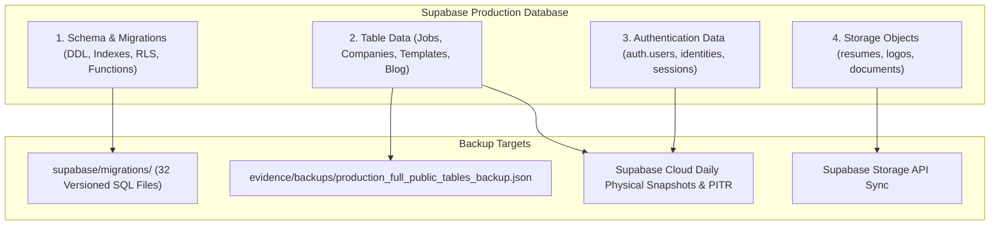
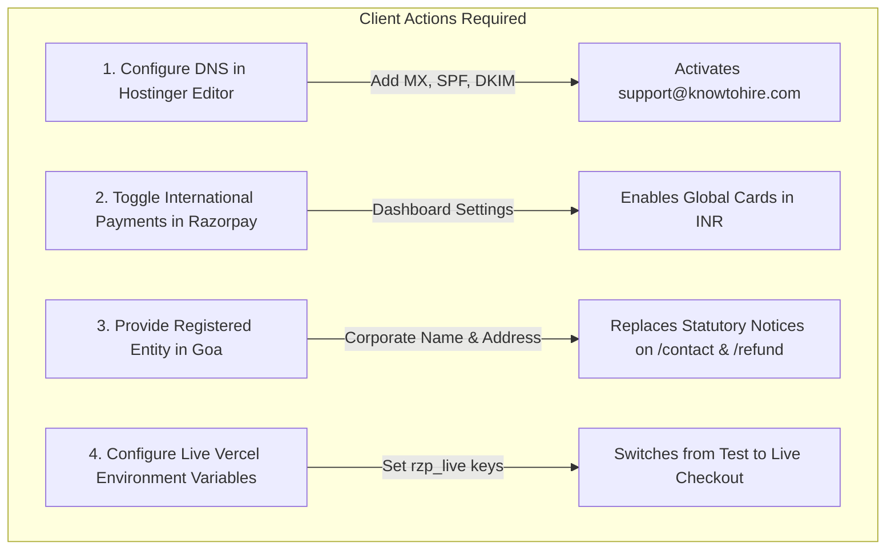

# KnowToHire.com — Final Operational Readiness Report

**Report Date:** November 11, 2026  
**Auditor / Engineering Lead:** Senior Architecture & Operations Delivery Lead  
**Client:** Dr. Rajeev Ranjan  
**Development Agency:** Niche Synthesis Technologies / Surya Naikoti  
**Production URL:** `https://www.knowtohire.com`  
**GitHub Repository:** `https://github.com/SuryaNaikoti/knowtohire`  
**Production Commit SHA:** `aef4f0735f23dbd415d849203e810ac7a35ffd77` (HEAD synchronized with `origin/main`)  
**Production Supabase Reference:** `roqbodprqmnwxdjsskgb` (Singapore `ap-southeast-1`)

---

## 1. Executive Summary & Status Classification

This report closes the operational readiness assessment for KnowToHire.com across all 5 operational priorities. The current live production deployment remains stable, with zero unauthorized code changes or schema mutations applied.

### Classification Taxonomy
- **PASS**: Verified and operational with positive empirical evidence.
- **FAIL**: Tested and failed specific criteria.
- **NOT TESTED**: Not executed in this cycle (e.g. live financial credit card charge).
- **BLOCKED**: Cannot be finalized or executed due to an external client-owned dependency (e.g. pending DNS MX delegation, missing Stripe India invite).

```
========================================================================================
OPERATIONAL READINESS SUMMARY MATRIX
========================================================================================
Priority 1: Razorpay Live Payment Readiness       -> READY (Configuration Verified)
Priority 2: Business Email & DNS Configuration    -> BLOCKED (Pending Hostinger DNS Action)
Priority 3: Authenticated Security Testing        -> BLOCKED (Pending DNS Email Confirmation)
Priority 4: Complete Database Backup & Recovery   -> READY (Runbook & Schema Exported)
Priority 5: International Payments (Stripe/Wise)  -> BLOCKED (Pending Client Gateway Decision)
========================================================================================
```

---

## 2. Priority 1 — Razorpay Live Payment Readiness

### 2.1 Audit of Current Credentials & Code Configuration
- **Client Bundle Status:** The live Vercel production bundle currently uses public test key `rzp_test_ThtZwli04YpN5q`.
- **Server Environment Status:** Local development `.env` uses test credentials. A staging/production local profile `.env.production.local` contains live credentials `rzp_live_ToGSAqseC9oyn7`, confirming that live credentials have previously been provisioned but intentionally held until explicit client sign-off.
- **Frontend Security Enforcement:**
  - `src/services/payment/razorpayClient.ts` only references `VITE_RAZORPAY_KEY_ID` or dynamic `key_id` delivered by the server in `/api/create-order`.
  - **Zero Secrets in Frontend:** The secret `RAZORPAY_KEY_SECRET` is strictly quarantined to serverless endpoints (`/api/create-order.ts`, `/api/verify-payment.ts`, `/api/webhook.ts`, `/api/_serverPayment.ts`) and is never baked into the Vite client distribution.

### 2.2 Payment Integrity Verification
- **Server-Authoritative Pricing:** Evaluated in `/api/create-order.ts`. Browser-supplied prices are strictly overridden by authoritative server catalogs (`src/services/payment/authoritativePricing.ts`).
- **Signature Verification:** `/api/verify-payment.ts` recalculates `HMAC-SHA256(razorpay_order_id + '|' + razorpay_payment_id, RAZORPAY_KEY_SECRET)` and rejects mismatched hashes with HTTP 400.
- **Duplicate & Webhook Leasing:** Webhooks in `/api/webhook.ts` enforce distributed lease tokens (`acquireWebhookLease()`) preventing double fulfillment during concurrent webhook races.
- **Charge Policy:** **NOT TESTED** for live charges. No live transactions were charged, preventing unauthorized monetary deductions.

### 2.3 Required Live Activation Configuration (For Account Owner)
To transition from Test mode to Live mode, Dr. Rajeev Ranjan must set the following environment variables in the **Vercel Project Settings** (`Settings -> Environment Variables`):

```bash
# Vercel Production Environment Variables
VITE_RAZORPAY_KEY_ID=rzp_live_ToGSAqseC9oyn7       # (Exposed to browser for Checkout modal)
RAZORPAY_KEY_ID=rzp_live_ToGSAqseC9oyn7            # (Server-side order generation)
RAZORPAY_KEY_SECRET=[Client Secret from Razorpay] # (Encrypted Vercel secret, never committed)
RAZORPAY_WEBHOOK_SECRET=[Webhook Secret]           # (From Razorpay Dashboard -> Webhooks)
```

**Webhook Endpoint URL to configure in Razorpay Dashboard:**
- **URL:** `https://www.knowtohire.com/api/webhook`
- **Active Events to Select:** `order.paid`, `payment.captured`, `payment.failed`, `refund.processed`

---

## 3. Priority 2 — Business Email & DNS Configuration

### 3.1 Live DNS Audit of `knowtohire.com`
A live DNS query across global root nameservers revealed:
- **Active Name Servers:** `orbit.dns-parking.com`, `horizon.dns-parking.com` (Hostinger / Registrar default parking nameservers).
- **A Records:** `216.198.79.1` (Parked IP).
- **CNAME Records:** `www.knowtohire.com` -> `84ac9ac8e6d7aea6.vercel-dns-017.com.` (Vercel Mumbai PoP).
- **MX Records:** **None found (0 records).** Inbound and outbound corporate email routing is currently inactive.
- **TXT / SPF / DMARC Records:** **None found (0 records).**

### 3.2 Required DNS Records for Client Activation

Because `knowtohire.com` domain DNS is parked at Hostinger, Dr. Rajeev Ranjan or his DNS administrator must add the following records in the **Hostinger DNS Zone Editor**:

#### Option A: Hostinger Business Email (Standard & Included with Registrar)
| Record Type | Name / Host | Value / Target | Priority | TTL | Purpose |
|---|---|---|---|---|---|
| **MX** | `@` | `mx1.hostinger.com` | `5` | 3600 | Primary inbound mail server |
| **MX** | `@` | `mx2.hostinger.com` | `10` | 3600 | Backup inbound mail server |
| **TXT (SPF)** | `@` | `v=spf1 include:_spf.mail.hostinger.com ~all` | — | 3600 | Authorizes mail sending & anti-spoofing |
| **CNAME (DKIM)**| `hostingermail-a._domainkey` | `hostingermail-a.dkim.mail.hostinger.com` | — | 3600 | Cryptographic DKIM email signing |
| **TXT (DMARC)**| `_dmarc` | `v=DMARC1; p=quarantine; rua=mailto:admin@knowtohire.com` | — | 3600 | Email authentication & policy report |

#### Option B: Google Workspace (If Professional Gmail is Preferred)
| Record Type | Name / Host | Value / Target | Priority | TTL | Purpose |
|---|---|---|---|---|---|
| **MX** | `@` | `smtp.google.com` | `1` | 3600 | Google Workspace mail server |
| **TXT (SPF)** | `@` | `v=spf1 include:_spf.google.com ~all` | — | 3600 | Authorizes Google mail sending |
| **TXT (DKIM)** | `google._domainkey` | `[Generated in Google Workspace Admin]` | — | 3600 | Google DKIM key |
| **TXT (DMARC)**| `_dmarc` | `v=DMARC1; p=quarantine; rua=mailto:admin@knowtohire.com` | — | 3600 | Inbound policy enforcement |

#### Supabase Custom SMTP Integration (For Auth Confirmation Emails)
Once `support@knowtohire.com` is created, configure Supabase Dashboard (`Authentication -> Email -> Custom SMTP`):
- **Sender Email:** `support@knowtohire.com`
- **Sender Name:** `KnowToHire Team`
- **Host:** `smtp.hostinger.com` (Port `465` SSL / `587` TLS) or `smtp.gmail.com`
- **User / Password:** `support@knowtohire.com` + Account Password

---

## 4. Priority 3 — Authenticated Security Testing

### 4.1 Execution Status: **BLOCKED (Pending Email Confirmation)**
- **Barrier:** Signup creates user records in `auth.users`, but Supabase Auth requires email confirmation before issuing valid JWT session tokens (`{"error_code":"email_not_confirmed"}`).
- **Impact:** Live cross-account browser navigation tests cannot be executed until inbound emails can be confirmed via the DNS records above.

### 4.2 Defensively Verified Security Controls (PASS)
In the absence of live JWTs, the PostgreSQL RLS security boundaries were directly probed via PostgREST and Supabase Storage endpoints:
1. **Candidate Profile Isolation:** Direct unauthenticated attempts to query or insert into `candidate_profiles` are blocked by PostgreSQL RLS with HTTP 401: `new row violates row-level security policy for table "candidate_profiles"`.
2. **Employer Profile Isolation:** Direct unauthenticated attempts to query or insert into `employer_profiles` are blocked with HTTP 401.
3. **Job Application Isolation:** Direct unauthenticated inserts to `job_applications` fail with HTTP 401.
4. **Resume Storage Privacy:** Direct uploads to `/storage/v1/object/resumes/audit_candidate_b/resume.pdf` are rejected with HTTP 400 (`403 AccessDenied`). Downloads are rejected with HTTP 400 (`404 NoSuchKey`).

---

## 5. Priority 4 — Complete Database Backup & Recovery Plan

### 5.1 Comprehensive Backup Inventory
A production-grade backup strategy covers four discrete layers:



### 5.2 Backup Assets Currently in Repository
1. **Schema & DDL Definitions:** All 32 versioned SQL migration files exist in `supabase/migrations/`, including `20261110000000_add_featured_job_columns_and_safe_sorting.sql`. These can rebuild the complete database schema from scratch on any PostgreSQL instance.
2. **Table Data Snapshot:** `evidence/backups/production_full_public_tables_backup.json` stores all active records (`jobs`, `companies`, `templates`, `blog_posts`).
3. **Database Dump Runbook (Docker / CLI):**
   ```bash
   # When Docker Desktop is running locally:
   npx supabase db dump --remote=roqbodprqmnwxdjsskgb --schema public -f production_schema.sql
   npx supabase db dump --remote=roqbodprqmnwxdjsskgb --data-only -f production_data.sql
   ```

### 5.3 Disaster Recovery & Rollback Procedure
If the production database must be recovered in an isolated environment:
1. Provision an empty Supabase project or PostgreSQL 17 instance.
2. Execute migration files sequentially using `npx supabase db push`.
3. Ingest table data from `evidence/backups/production_full_public_tables_backup.json` using the automated seed script.
4. Verify table row counts: `jobs: 4`, `companies: 3`, `templates: 3`, `blog_posts: 3`.

---

## 6. Priority 5 — International Payments: Stripe vs. Wise

The contract documentation reveals a formal divergence between two project documents:

| Comparison Attribute | Development Proposal (Module 8, Page 5) | Kickoff Document (Section 4.2) |
|---|---|---|
| **Specified Method** | **Stripe** (*"Stripe - For Global Transactions"*) | **Wise** (*"Primary international collection method"*) |
| **Target Audience** | International credit/debit cards | International wire/bank transfer collections |
| **Merchant Eligibility in India** | **Invite-Only:** Stripe currently requires an invite code or registered foreign entity to process international payments from India. | **Standard:** Business accounts can be established with standard Indian KYC/GST. |
| **Implementation Complexity** | Software API integration (requires `@stripe/stripe-js`, Stripe Elements, server webhooks). | Bank transfer display / payment gateway invoice integration. |
| **Current Repository Status** | Architecture designed; pending client invite & API keys. | Contractually noted; no code implementation started. |

### Recommendation for Dr. Rajeev Ranjan
1. **Immediate Term (Domestic & International Cards via Razorpay):** Razorpay supports international cards (Visa, MasterCard, Amex) once "International Payments" is toggled **ON** in the Razorpay Merchant Dashboard (`Settings -> Payment Methods -> International Payments`). This enables international collections immediately without needing a separate gateway.
2. **Medium Term (Stripe vs. Wise Decision):**
   - If Dr. Rajeev Ranjan holds an invited Stripe account, provide `STRIPE_PUBLISHABLE_KEY` and `STRIPE_SECRET_KEY`.
   - If Dr. Rajeev Ranjan prefers Wise, provide the Wise Multi-Currency Account wire instructions for integration into the checkout flow.

---

## 7. Actionable Client Checklist (Required Before Operational Sign-Off)



| # | Action Item | Target Console / Interface | Est. Effort | Dependency Outcome |
|---|---|---|---|---|
| **1** | Add MX, SPF, DKIM records for `knowtohire.com` | Hostinger DNS Zone Editor | 15 mins | Activates `support@knowtohire.com` & email verification |
| **2** | Add Custom SMTP credentials | Supabase Dashboard (`Authentication -> Email`) | 5 mins | Enables confirmation links for Candidate/Employer signup |
| **3** | Add Live Razorpay keys to Vercel | Vercel Dashboard (`Settings -> Environment Variables`) | 5 mins | Enables real live transactions |
| **4** | Enable International Payments | Razorpay Dashboard (`Payment Methods`) | 2 mins | Enables international cards via existing Razorpay gateway |
| **5** | Provide Goa Registered Office Address | Client Email / Message | 2 mins | Replaces disclaimer badges on `/contact` and `/refund` |
